[](https://github.com/abiodunosagie/shipcheck/actions/workflows/ci.yml)

A command-line tool, written in Rust, that audits a website before launch. Point it at a live URL or at a local build folder. It crawls every page on the site, checks every link and resource once, and reports what would embarrass you after launch: broken links, blank link previews, images without descriptions, oversized images, and missing basics such as the viewport tag, robots.txt and sitemap.xml.

The exit code makes it a CI gate. A pull request that breaks a link or drops the link-preview image fails the build.

## Quick start

```bash
git clone https://github.com/abiodunosagie/shipcheck.git
cd shipcheck
cargo install --path .

shipcheck https://example.com        # a live site
shipcheck ./out                      # a local build folder (Next.js out/, Vite dist/, Hugo public/)
```

A local folder is served by a small built-in server on `127.0.0.1`, so you can audit a static build before deploying it.

## Example

Run against the broken test site in `tests/fixtures/bad` (the local server picks a free port, shown here as 8080):

```
$ shipcheck tests/fixtures/bad --no-external
>✓ shipcheck checking http://127.0.0.1:8080/

http://127.0.0.1:8080/
  error   broken-link      link returns HTTP 404: http://127.0.0.1:8080/nowhere
  error   broken-resource  image returns HTTP 404: http://127.0.0.1:8080/missing.png
  error   img-alt          image without alt text: /missing.png (use alt="" if decorative)
  error   og-image         og:image must be an absolute URL, got "/og.png"; most platforms ignore relative ones
  error   viewport         missing viewport meta tag, the page will not scale on phones
  warning canonical        missing canonical link
  warning description      missing meta description
  warning favicon          no favicon declared and no /favicon.ico
  warning h1               2 <h1> elements; use one per page
  warning lang             missing lang attribute on <html>, screen readers guess the language
  warning og-description   missing og:description
  warning og-title         missing og:title, link previews fall back to the page title
  warning robots           missing robots.txt
  warning sitemap          missing sitemap.xml, search engines discover pages more slowly
  warning twitter-card     missing twitter:card, X shows a small preview or none

http://127.0.0.1:8080/blog/
  error   broken-link      link returns HTTP 404: http://127.0.0.1:8080/gone.html
  error   og-image         missing og:image, shared links show a blank preview
  warning canonical        missing canonical link
  warning description      missing meta description
  warning og-description   missing og:description
  warning og-title         missing og:title, link previews fall back to the page title
  warning twitter-card     missing twitter:card, X shows a small preview or none

2 pages, 5 links and resources checked: 7 errors, 15 warnings
```

## What it checks

Errors fail the run by default. Warnings are reported but do not fail it unless you pass `--fail-on warning`.

| Check | Severity | What it means |
|---|---|---|
| `fetch` | error | The start page fails to load, or is not HTML, so nothing could be checked. |
| `broken-link` | error | A link returns 4xx or 5xx, or cannot be reached. |
| `broken-resource` | error | An image, script, stylesheet, icon or og:image fails to load. |
| `og-image` | error | Missing, relative, or not served as an image. Shared links then show a blank preview. |
| `img-alt` | error | An image has no `alt` attribute. `alt=""` is accepted for decorative images. |
| `viewport` | error | No viewport meta tag, so the page does not scale on phones. |
| `mixed-content` | error | An `https` page loads any resource (image, script, stylesheet, icon or og:image) over `http`. |
| `title` | error / warning | Missing title (error), or longer than 60 characters (warning). |
| `image-size` | warning | An image or og:image is larger than `--max-image-kb` (300 KB by default). |
| `description` | warning | Missing meta description, or outside 50 to 160 characters. |
| `h1` | warning | No `<h1>`, or more than one. |
| `lang` | warning | No `lang` attribute on `<html>`. |
| `canonical` | warning | No canonical link. |
| `og-title`, `og-description`, `twitter-card` | warning | Missing link-preview tags. |
| `robots`, `sitemap`, `favicon` | warning | Missing site-wide files. |
| `crawl-limit` | warning | The crawl stopped at `--max-pages` before reaching every page. |

Links to other sites are checked too. Many large sites answer automated requests with 401, 403 or 429 even when the page is fine, so for external links those answers, and timeouts, are warnings rather than errors.

## Options

```
shipcheck [OPTIONS] <TARGET>

  <TARGET>                 A URL (https://example.com) or a local folder of built HTML
  --max-pages <N>          Stop crawling after this many pages, at least 1 [default: 200]
  --concurrency <N>        How many links to check at once, 1 to 64 [default: 8]
  --timeout <SECONDS>      Seconds to wait for each request, 1 to 120 [default: 15]
  --no-external            Only check links within the site
  --max-image-kb <KB>      Warn about images larger than this [default: 300]
  --json                   Print the report as JSON instead of text
  --fail-on <LEVEL>        error (default), warning, or never
```

Exit codes: `0` when the run passes, `1` when it finds problems at the `--fail-on` level, `2` for a usage error such as a target that is neither a folder nor a URL.

## Use it in CI

Audit a static build before it deploys, for example in GitHub Actions:

```yaml
- name: Build the site
  run: npm ci && npm run build          # writes ./out

- name: Install shipcheck
  run: cargo install --git https://github.com/abiodunosagie/shipcheck

- name: Audit the build
  run: shipcheck ./out --no-external
```

`--json` gives a machine-readable report (site, pages checked, links checked, and every issue with its page, check, severity and message) for dashboards or bots.

## How it works

1. **Crawl.** Starting from the target, it fetches same-site HTML pages breadth first and analyses each one: the head tags, the headings, the images, and every link and resource it references. `/about`, `/about/` and `/about?ref=x` count as one page, and the crawl stops at `--max-pages`.
2. **Check.** Every unique link and resource across the whole site is checked once, concurrently (`futures::buffer_unordered`), and a failure is reported on every page that references it. It sends HEAD first, because it is cheap, and retries with GET whenever HEAD fails, since some servers answer HEAD with 403, 404 or 405 for pages that work.
3. **Site-wide files.** robots.txt, sitemap.xml, and a favicon when no page declares one.

Some details that matter on real sites:

- **Redirects keep the crawl on the site.** Starting at `http://example.com` when the site lives at `https://www.example.com` is the usual case, so the origin the start page redirects to counts as the same site.
- **Image sizes are measured, not guessed.** CDNs often answer HEAD over HTTP/2 without a `Content-Length`. When that happens for an image, shipcheck makes a GET and counts the bytes, so an oversized image is never silently skipped.
- **One report per failure.** A broken page is reported as a broken link on each page that links to it, not a second time as a page. When one URL is a link on one page and an image on another, it gets the image checks.
- **Tags are read the way crawlers read them.** Attribute values match in any case, Open Graph tags count under `property=` or `name=`, and relative URLs follow `<base href>`.
- **Links that cannot be fetched are skipped,** such as `mailto:`, `tel:`, `javascript:`, `data:` and in-page `#fragments`.
- **The local server stays inside its folder.** Paths are percent-decoded before they are checked, so `..`, `%2e%2e` and encoded backslashes cannot climb out, and the real path is checked after following symlinks. Hidden files such as `.env` are never served (`.well-known` is). It binds to `127.0.0.1` on a free port, answers GET and HEAD only, and accepts only its own `Host` header, so a web page in your browser cannot reach it through DNS rebinding. It resolves `/about` to `about.html` or `about/index.html` the way static hosts do.
- **Untrusted pages cannot fool the terminal.** Messages quote attributes from the audited page, so control characters are replaced before printing; a crafted `src` cannot clear the screen or forge report lines. Page bodies are read up to 10 MB.
- **TLS through rustls,** with gzip and brotli decoding and HTTP/2.

Like any link checker, shipcheck requests every URL the audited pages link to, including addresses on your own network if a page links to them. Run it against sites you trust, or with `--no-external`, on machines with access to internal services.

## Tests

```bash
cargo test
```

CI runs formatting and Clippy with warnings denied, the full test suite on Linux, macOS and Windows, and a build on the minimum supported Rust version (1.88). The tests need no network: each one serves a site from `127.0.0.1`.

- `tests/page_checks.rs` checks the page analysis: a complete page has no issues, an empty page reports every missing basic, relative og:image is an error, `alt=""` is accepted, mixed content applies to resources but not links, links are resolved, deduplicated and filtered, `<base href>` is followed, and tags match in any case.
- `tests/site.rs` crawls whole sites end to end:
  - A complete site passes with zero issues.
  - A broken site reports its broken links, broken images, bad tags and missing files, and each broken link exactly once.
  - A start page that fails, or is not HTML, is an error rather than a silent pass.
  - A start URL that redirects to another origin is still crawled, and its links still count as internal.
  - The crawl limit is respected and reported.
  - An image served without a `Content-Length` is still measured, and a URL used as both link and image gets the image checks.
  - The local server refuses paths that leave its folder, sibling files, symlinks out, hidden files and foreign `Host` headers, and reads a request split across packets.
- `tests/cli.rs` runs the binary: exit codes 0, 1 and 2, `--fail-on`, the text report and valid JSON.
- Unit tests in `crawl.rs` cover how each HTTP outcome is judged, including blocked external links as warnings.

## Project layout

```
src/
  main.rs     command-line options, local folder or URL, exit codes
  crawl.rs    crawl, concurrent link checking, site-wide files
  page.rs     per-page analysis: head tags, headings, images, links and resources
  serve.rs    local static file server for build folders
  report.rs   text and JSON output, the opening line with the >✓ mark
  model.rs    issues, severities and the report
tests/
  page_checks.rs   page analysis
  site.rs          end-to-end crawls and the local server
  cli.rs           the binary: exit codes and output
  fixtures/        a complete site and a broken site
brand/            logo masters, banner and guidelines (python3 brand/generate.py)
```

## License

MIT. See [LICENSE](LICENSE).

## Author

Abiodun Osagie, mobile, front-end and full-stack developer.
[Portfolio](https://smithportfolio.smitho.workers.dev) · [GitHub](https://github.com/abiodunosagie) · [LinkedIn](https://linkedin.com/in/osagieabiodun)
